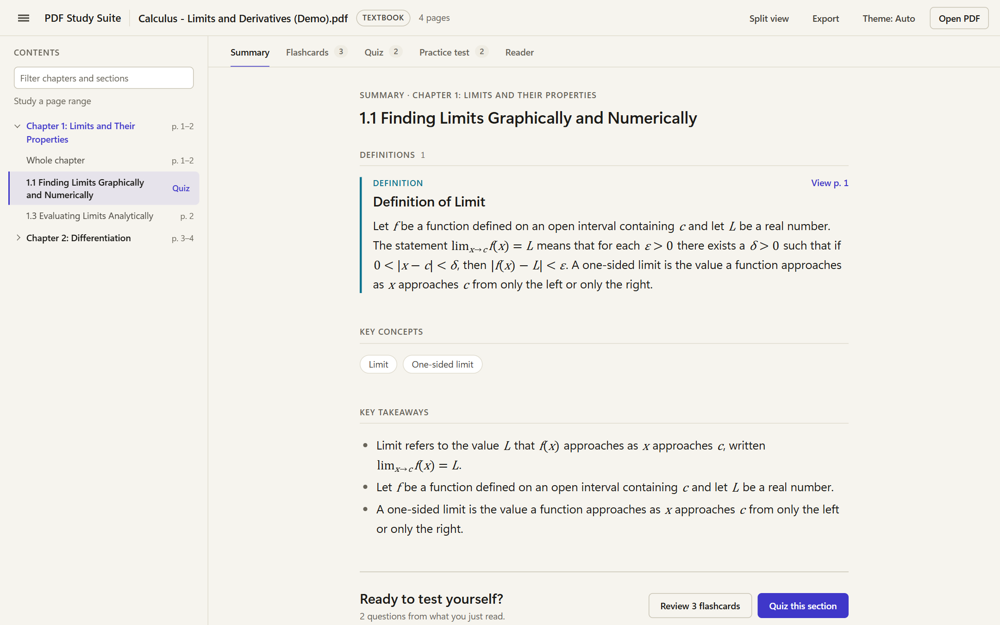
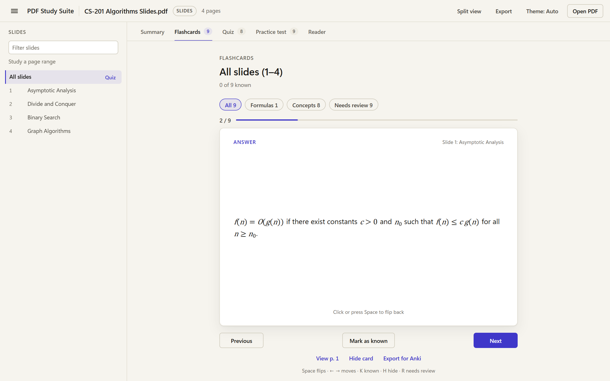
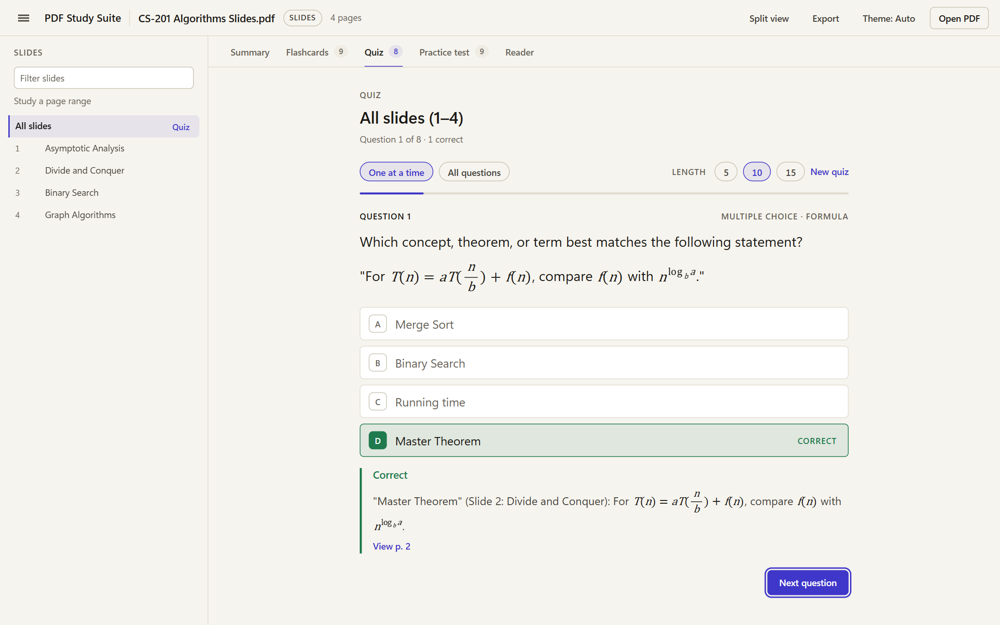
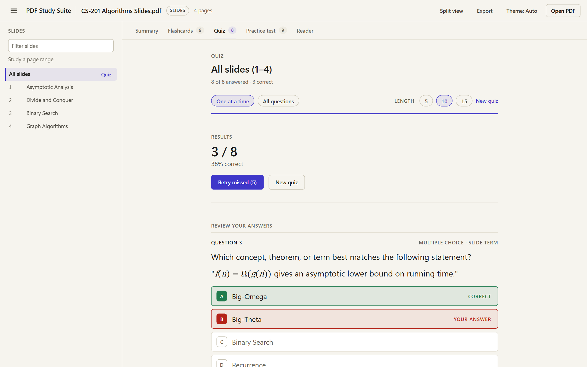
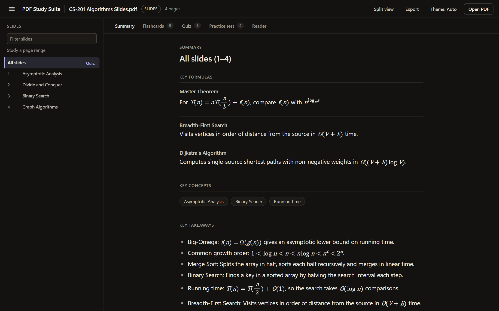
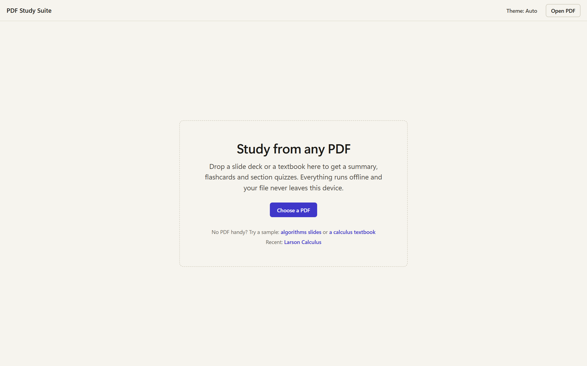
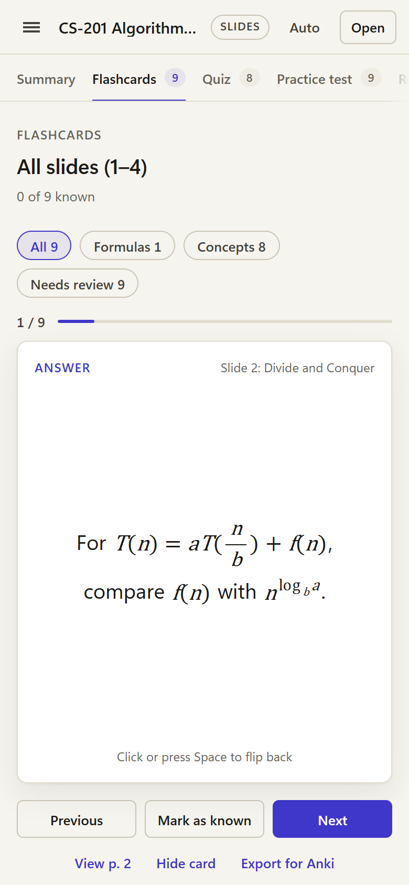

# PDF Study Suite

Turn any lecture deck or textbook PDF into a summary, flashcards and a quiz for each section.
It runs entirely in your browser: no account, no uploads, no AI service, no internet needed.

**Try it now: [sinbhad.github.io/PDF-Study-Suite](https://sinbhad.github.io/PDF-Study-Suite/)** — nothing to install.



## What it does

- **Reads slides and textbooks.** It works out which kind of document you opened, builds an outline (slides, or chapters and sections), and lets you study any part of it.
- **Summaries that keep the math.** Definitions, theorems and formulas are pulled out and shown as formatted text and equations, with a link back to the page they came from.
- **Flashcards.** Term and definition cards, theorem cards, and the question-and-answer slides your lecturer already put in the deck. Mark cards as known, filter by kind, export to Anki.
- **A quiz for every section.** Pick a chapter, a section or a slide range and get multiple choice, fill-in-the-blank, true/false and show-the-answer questions built from that material. When you finish you get your score and a review of every answer, missed ones first, with a one-click retry. There is also a longer practice test with an optional timer.
- **Handwritten and scanned pages (in progress).** Reading PDFs that have no selectable text — handwritten notes or a scanned book — is in progress and is currently hidden from the live app. You can still open those files in the built-in reader, but summaries, flashcards and quizzes are built from digital PDFs with selectable text. We are actively looking for methods to do this without the use of AI.
- **Skips the filler.** Copyright notices, author pages, prefaces, photo credits and figure labels are left out. Exercise sets are kept out of the summaries.
- **Built-in reader.** View the original page beside your notes with split view.
- **Works on a phone.** The layout adapts to small screens, and there are light and dark themes.

| Flashcards | Section quiz |
| --- | --- |
|  |  |

| Review your answers | Dark theme |
| --- | --- |
|  |  |

| Start screen | On a phone |
| --- | --- |
|  |  |

## Getting started

### Online

Open **[sinbhad.github.io/PDF-Study-Suite](https://sinbhad.github.io/PDF-Study-Suite/)** and drop in a PDF.
The page only delivers the app; your PDF is still read by your own browser and is never uploaded.

### On your own computer (works offline)

You need [Python 3.8 or newer](https://www.python.org/downloads/). Nothing else has to be installed.

1. Download this repository (green **Code** button, then **Download ZIP**) and unzip it, or clone it.
2. Start the app:
   - **Windows:** double-click `run.bat`.
   - **Mac or Linux:** open a terminal in the folder and run `python3 app.py`.
3. Your browser opens at `http://127.0.0.1:8765`. Drop a PDF onto the page, or click **Choose a PDF**.

No PDF to hand? Use the two sample links on the start screen.

To stop the app, close the terminal window or press `Ctrl+C` in it.

The math font (STIX Two, about 0.85 MB) is already included. `python tools/fetch-math-font.py` re-downloads it from [github.com/stipub/stixfonts](https://github.com/stipub/stixfonts) (v2.13) if you ever need to restore it.

## Using it

1. **Open a PDF.** Large textbooks open quickly because pages are read only when you study them.
2. **Pick what to study** in the outline on the left: a chapter, a section, a slide, or a custom page range.
3. **Read the Summary**, then use **Quiz this section** at the bottom, or the **Quiz** button next to any outline entry. After the last question, review what you missed and retry just those.
4. **Flashcards** and **Practice test** have their own tabs. **Reader** shows the original pages.

If the app guesses the document type wrong, click the **Slides** / **Textbook** badge next to the title to switch.

### Keyboard shortcuts

| Where | Keys |
| --- | --- |
| Flashcards | `Space` flip, `←` `→` previous and next, `K` mark known, `H` hide card, `R` needs review, `0`–`7` filters |
| Quiz | `A`–`D` or `1`–`4` to answer; on show-the-answer questions `Space`, then `G` (got it) or `M` (missed it) |

## Good to know

- **Your files stay on your computer.** The app is a small local web page; the PDF is read by your browser and never sent anywhere.
- **It is rule-based, not AI.** Questions and cards are built from what the PDF actually says, so quality depends on the document. Material with clear definitions, theorems and formulas works best; sections that are all prose get fewer and simpler questions.
- **Handwritten and scanned pages are not read yet.** The live app and the default local build only use the selectable text already in the PDF. Image-only or handwritten pages open in the reader, but they will not produce a summary, flashcards or a quiz until this in-progress feature is ready. We are actively looking for methods to do this without the use of AI.
- **Textbooks work best when the PDF has bookmarks** (a built-in table of contents), which is how chapters and sections are found.
- Always check anything important against the source page. The **View p. N** links are there for that.

## Suggestions and bug reports

Found something broken, or have an idea that would make studying easier? Use one of these short forms:

- **[Report a problem](https://github.com/Sinbhad/PDF-Study-Suite/issues/new?template=bug_report.yml)** — something broke, looked wrong, or a PDF came out badly.
- **[Suggest an improvement](https://github.com/Sinbhad/PDF-Study-Suite/issues/new?template=suggestion.yml)** — a feature or change you would like.

You need a free GitHub account to submit. Please don't attach copyrighted textbooks or course material; a description or a small screenshot is enough.

To keep spam out, reports have to come through the forms, and an automatic check closes anything that is empty, a dump of links, or obvious advertising. If yours gets closed by mistake, just open a new one with a sentence or two describing the issue.

## For developers

Plain HTML, CSS and JavaScript with no build step and no dependencies beyond the bundled [PDF.js](https://mozilla.github.io/pdf.js/). The STIX Two math font is included.

```
index.html        page shell and script order
app.py            tiny local web server (no-cache), opens the browser
src/pdf/          text extraction: lines, columns, math, slides, book outline, filler removal
src/nlp/          summaries, key terms, flashcards, quiz and practice-test generation
src/hw/           handwriting and scanned-page reading (in progress; hidden from the live app)
src/ui/           views, outline, reader, theme, storage
styles/           design tokens and component styles
tests/            fixture suites and the verification script
tools/run-pdf.js  run the whole pipeline on a PDF from the command line
tools/fetch-math-font.py  re-downloads the STIX Two math font (checksum-verified)
tools/eval-text.js          counts extraction defects on a fixed set of pages of a digital PDF
docs/             MATH-FONT.md, screenshots, and working notes
vendor/           PDF.js; fonts/ (STIX Two)
```

Run the checks (needs Python 3.10+ and Node.js):

```bash
python tests/verify_suite.py
```

Inspect what the pipeline produces for a PDF without opening the browser:

```bash
node tools/run-pdf.js path/to/file.pdf 1 20 --out=report.json
```

Every source file is kept to 250 lines or fewer; the verification script enforces it.

## Credits

PDF parsing and page rendering use [PDF.js](https://github.com/mozilla/pdf.js) by Mozilla, licensed under Apache 2.0.

Math is set in the [STIX Two](https://github.com/stipub/stixfonts) fonts by the STI Pub Companies, licensed under the SIL Open Font License 1.1 (`vendor/fonts/stix-two/OFL.txt`).
